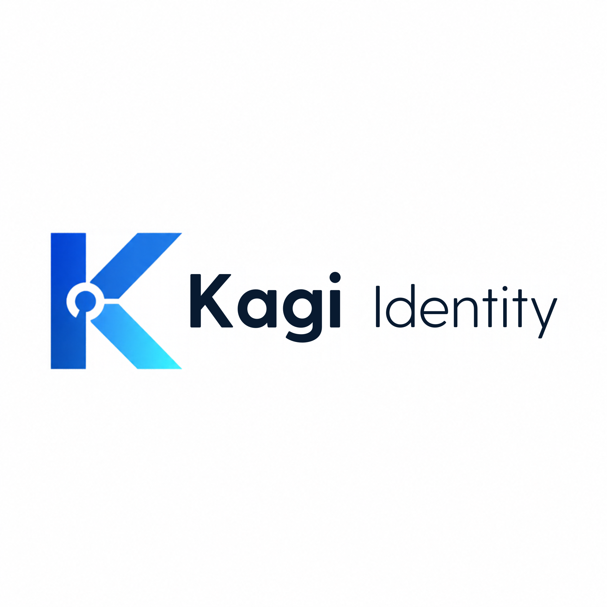

# Kagi Identity



**Kagi Identity (Kagi ID)** is a passkey-first identity and authentication service built in Rust. It provides WebAuthn-based sign-in and OpenID Connect / OAuth endpoints for applications that need an identity provider.

> **Status and security note:** This repository is a reference implementation under active development. Passing its tests does not establish formal OAuth, OpenID Connect, FAPI, or WebAuthn certification. Do not use it as a production identity provider without profile-specific conformance testing, independent security review, and a deployment threat model.

## Get started in minutes

The fastest way to try Kagi Identity is Docker Compose. You need Docker Engine/Desktop with the Compose plugin.

```bash
docker compose up --build -d
docker compose logs -f kagi
```

Then open:

| What | URL |
| --- | --- |
| Identity home | [http://localhost:8080/](http://localhost:8080/) |
| Create a passkey account | [http://localhost:8080/signup](http://localhost:8080/signup) |
| Account console (after sign-in) | [http://localhost:8080/](http://localhost:8080/) |
| Try the built-in demo app | [http://localhost:8080/demo](http://localhost:8080/demo) |
| OIDC discovery document | [http://localhost:8080/.well-known/openid-configuration](http://localhost:8080/.well-known/openid-configuration) |
| Public signing keys | [http://localhost:8080/jwks.json](http://localhost:8080/jwks.json) |

1. Open `/signup` and create an account with a passkey.
2. Manage your profile, passkeys, devices and connected apps on `/`.
3. Open `/demo` and sign in to see the authorization-code flow.
4. Stop the service with `docker compose down`. Your local database and signing keys remain in the `kagi-data` volume.

To delete the local test database and keys as well, run `docker compose down --volumes`. This deletion is irreversible.

**This Compose configuration is for local evaluation only.** It uses HTTP, seeds a demo client, allows signup, and binds the published port to loopback. Never expose it as-is to the public internet.

### Self-hosted production template

For a portable Linux/Docker deployment, use `compose.production.yaml` with `.env.production.example`. It places Kagi behind Caddy-managed HTTPS, keeps the application container private and hardened, and connects to an external TLS-enabled PostgreSQL database. Set `KAGI_ENV=production`; the application then refuses to start unless its production security prerequisites are met. Follow the [deployment guide](docs/DEPLOYMENT.md), apply the PostgreSQL schema before startup, and keep real secrets outside the repository.

The same Dockerfile can be built as an OCI image for container platforms such as managed container services or Kubernetes. Configure HTTPS ingress, private networking, a TLS-enabled PostgreSQL database, the production environment variables, and `/healthz` readiness as described in the [deployment guide](docs/DEPLOYMENT.md).

The production template is a deployment baseline, not a managed database, backup service, KMS, security certification, or substitute for independent assessment.

### Run without Docker

Install the Rust toolchain required by `Cargo.toml`, then:

```bash
cp .env.example .env
set -a
. ./.env
set +a
cargo run
```

Open [http://localhost:8080](http://localhost:8080). The `.env` file is local configuration; do not commit secrets. On Windows, set environment variables in PowerShell or use WSL rather than sourcing the POSIX file.

For troubleshooting, configuration, and setup options, see the [Quickstart guide](docs/QUICKSTART.md).

> パスキーは secure context でのみ動作します。`localhost` は例外的に許可されますが、
> LAN の IP や独自ドメインで動かす場合は必ず HTTPS terminate してください
> (`KAGI_ISSUER=https://id.example.com`, `KAGI_RP_ID=example.com`)。

## What it provides

| Area | Capabilities |
| --- | --- |
| Authentication | Passkey-first WebAuthn registration and sign-in; discoverable credentials, conditional UI, `none` / `packed` self-attestation, signature-counter clone detection, BE/BS flags |
| Authorization | Authorization Code flow, PKCE S256, state/nonce handling, consent, `prompt=none/login/consent`, remembered consent, `max_age`, RFC 9207 `iss` |
| OAuth/OIDC | Discovery, JWKS, UserInfo, introspection, revocation, logout, dynamic client registration |
| Advanced profiles | PAR (RFC 9126), DPoP (RFC 9449, `cnf.jkt` + `ath` + `jti` replay protection), JAR (RFC 9101), JARM (`response_mode=jwt/query.jwt/fragment.jwt`) |
| Client authentication | `client_secret_basic`, `client_secret_post`, `private_key_jwt` (RS256/PS256/ES256/EdDSA) and public clients |
| Tokens | ES256-signed JWT access tokens (`typ: at+jwt`), refresh-token rotation with reuse detection (family revocation), `at_hash`, `sid` |
| Key lifecycle | Persistent signing keys, JWKS publication, administrative key rotation with a grace period |
| Storage | SQLite by default; PostgreSQL/Supabase via `KAGI_DATABASE_URL` |
| Integration | Built-in demo RP and browser SDK at `/static/kagi.js`; CORS-controlled API |
| Account console | Profile editing, passkey add/rename/delete, device (session) list with single/bulk sign-out, connected-app revocation, recovery codes, audit events, account deletion |
| Operations | Rate limiting, audit log, `/healthz` and `/readyz` (with database probe), `/admin/stats`, start-up configuration validation |
| Security controls | PKCE enforcement, exact redirect URI matching, Origin + `Sec-Fetch-Site` checks, CSRF tokens, CSP/HSTS/COOP/CORP/Permissions-Policy, HttpOnly + SameSite=Lax sessions, SHA-256 at rest for all tokens |

Feature presence does not imply full normative compliance with every RFC or certification profile. Confirm actual behavior against the exact commit and configuration you deploy.

## Account console and recovery

After sign-in, `/` is a passkey-only account console.

- **Profile**: update display name and email address; changes are reflected by UserInfo immediately.
- **Passkeys**: add, rename and delete. The last remaining passkey cannot be deleted, which prevents lock-out.
- **Devices**: list sessions with device, IP and last activity; revoke one or all. Revocation also invalidates access and refresh tokens issued from that session.
- **Connected apps**: list authorized clients and revoke consent.
- **Recovery codes**: generate 10 single-use codes (`ABCDE-FGHJK`). Only a salted, iterated SHA-256 digest of the normalized code is stored; the plaintext is shown once, immediately after generation.
- **Security events**: recent sign-ins, failures, passkey changes and session revocations from the audit log.
- **Delete account**: re-enter the username, then passkeys, sessions, tokens and consents are removed. The audit trail is kept (and purged after `KAGI_AUDIT_RETENTION_DAYS`) so the deletion itself stays auditable.

Recovery codes are the fallback when no passkey is available. `GET /recover` with a username and code issues a session with `amr=["pwd","otp"]`. A code is invalidated on use, and regenerating the set invalidates all previous codes. Set `KAGI_RECOVERY_ENABLED=0` to disable the feature entirely.

State-changing browser POSTs are validated with `Origin` and `Sec-Fetch-Site`. OAuth protocol endpoints (`/par`, `/token`, ...) are exempt because RPs call them cross-origin; they are protected by OAuth/DPoP validation instead.

## Documentation

**[日本語ドキュメントサイト](https://kagi-docs-gakusei-bot.vercel.app)** — overview, quickstart, OIDC integration, deployment, security, and testing.

| Guide | Use it for |
| --- | --- |
| [Quickstart](docs/QUICKSTART.md) | First run with Docker Compose or Rust, troubleshooting |
| [Deployment](docs/DEPLOYMENT.md) | HTTPS, reverse proxies, secrets, storage, production checklist |
| [Client integration](docs/CLIENT_INTEGRATION.md) | Registering an RP and connecting a web app |
| [Configuration reference](docs/CONFIGURATION.md) | Environment variables and recommended baselines |
| [Testing](docs/TESTING.md) | Rust checks, E2E tests, security regression tests |
| [Security policy](SECURITY.md) | Vulnerability reporting and security expectations |

## Integration at a glance

For evaluation, the built-in SDK can initiate a login from a browser:

```html
<script src="https://id.example.com/static/kagi.js"></script>
<script>
  Kagi.configure({
    issuer: "https://id.example.com",
    clientId: "YOUR_CLIENT_ID",
    redirectUri: location.origin + "/auth/callback",
    scope: "openid profile email"
  });
  Kagi.login();
</script>
```

Register the exact callback URL first. For production applications, prefer a maintained OIDC client library and validate the protocol, token, and session behavior appropriate to your application. See [Client integration](docs/CLIENT_INTEGRATION.md).

## Configuration essentials

The most important values are:

- `KAGI_ISSUER`: public issuer origin, without a trailing slash.
- `KAGI_ORIGIN`: browser origin used for WebAuthn validation; usually the same as the issuer.
- `KAGI_RP_ID`: bare WebAuthn domain, with no scheme or port.
- `KAGI_DATABASE_URL`: optional PostgreSQL/Supabase connection string; when set, it takes precedence over `KAGI_DB`.
- `KAGI_SEED_DEMO`: enables the local demo RP; keep it disabled in production.
- `KAGI_ADMIN_TOKEN` and `KAGI_REGISTRATION_TOKEN`: administrative and client-registration secrets; keep them in a secret manager.
- `KAGI_RECOVERY_ENABLED`, `KAGI_MAX_PASSKEYS`, `KAGI_AUDIT_RETENTION_DAYS`: account-console policy.
- `KAGI_CORS_ORIGINS`: exact HTTPS origins allowed to call the API; wildcards are rejected.
- `KAGI_TRUST_PROXY`: trust the first `X-Forwarded-For` hop; only behind a proxy that overwrites the header.

See the full [configuration reference](docs/CONFIGURATION.md). Keep the issuer, origin, RP ID, and browser-visible URL aligned or passkey ceremonies will fail.

## Supabase (PostgreSQL)

```bash
export KAGI_DATABASE_URL='postgresql://postgres.<ref>:<password>@aws-0-<region>.pooler.supabase.com:5432/postgres?sslmode=require'
export KAGI_ISSUER=https://id.example.com
cargo run --release
# [kagi] database postgres
```

- `supabase/schema.sql` is the single source of truth and can also be applied manually.
- Booleans are stored as `BIGINT` (0/1) so the same SQL works against SQLite and PostgreSQL.
- Kagi connects as the **service role / postgres user** and bypasses RLS. Never expose these tables directly with the Supabase anon/authenticated keys.
- Signing keys are stored in the database, so database backups contain key material. Consider a KMS/HSM for production.
- Set `KAGI_AUTO_MIGRATE=0` in serverless production after applying the schema yourself.

## Run tests

```bash
cargo check --all-targets
cargo test --all-targets
cargo clippy --all-targets
cargo build --release
```

For Python end-to-end and security regression tests, install `requirements-test.txt` and follow the isolated test setup in [Testing](docs/TESTING.md). Tests may seed records directly into their database: never point them at production data.

```bash
# 1) Core + JARM/DPoP + WebAuthn (software authenticator, no password)
KAGI_SEED_DEMO=1 KAGI_DB=kagi-e2e.db cargo run
KAGI_DB=kagi-e2e.db python scripts/e2e_oidc.py
KAGI_DB=kagi-e2e.db python scripts/e2e_advanced.py
python scripts/e2e_webauthn.py

# 2) Admin (DCR initial token, private_key_jwt, JAR, key rotation)
KAGI_SEED_DEMO=1 KAGI_DB=kagi-e2e.db \
KAGI_ADMIN_TOKEN=test-admin KAGI_REGISTRATION_TOKEN=reg-secret cargo run
python scripts/e2e_admin.py

# 3) Account console / recovery / audit / admin stats
KAGI_SEED_DEMO=1 KAGI_DB=kagi-account.db \
KAGI_RECOVERY_ENABLED=1 KAGI_ADMIN_TOKEN=test-admin cargo run
python scripts/e2e_account.py
```

| Script | Coverage |
| --- | --- |
| `e2e_oidc.py` | PAR, consent, PKCE, code exchange, ID token signature, UserInfo, introspection, RT rotation and reuse detection, revocation, `prompt=none`, DPoP binding |
| `e2e_advanced.py` | JARM (`response_mode=query.jwt`), DPoP key continuity across PAR → code → token, CORS preflight, `max_age=0` |
| `e2e_webauthn.py` | Sign-up/sign-in with a software authenticator, origin/type/challenge validation, tampered signatures and counter rollback rejection |
| `e2e_admin.py` | DCR with an initial access token, `private_key_jwt`, assertion replay/aud validation, JAR signature validation, key rotation, logout redirect validation |
| `e2e_account.py` | Profile update, passkey add/rename/delete, multiple sessions and bulk revocation, consent revocation, recovery code generation and single use, cross-origin POST rejection, `/healthz`, `/admin/stats`, account deletion |
| `e2e_rate_limit.py` | Shared rate-limit counters across repeated requests |
| `e2e_security_races.py` | Concurrent ceremony and refresh-token reuse races |

`e2e_oidc.py` and `e2e_advanced.py` insert sessions directly into the database, so run them with the same `KAGI_DB` as the server. `e2e_account.py` expects `KAGI_SEED_DEMO=1`, `KAGI_RECOVERY_ENABLED=1` and `KAGI_ADMIN_TOKEN=test-admin`. The same scripts work against PostgreSQL/Supabase: only the server-side `KAGI_DATABASE_URL` changes.

PAR returns `201 Created` as required by RFC 9126.

## Authorization code flow (curl)

`demo-web` is a public client, so PKCE is sufficient.

```bash
VERIFIER=$(openssl rand -base64 48 | tr '+/' '-_' | tr -d '=')
CHALLENGE=$(printf '%s' "$VERIFIER" | openssl dgst -binary -sha256 | openssl base64 -A | tr '+/' '-_' | tr -d '=')

# 1. PAR
curl -s -X POST http://localhost:8080/par \
  -d client_id=demo-web \
  -d response_type=code \
  -d redirect_uri=http://localhost:3000/callback \
  -d scope="openid profile email offline_access" \
  -d state=xyz \
  -d nonce=n-123 \
  -d code_challenge="$CHALLENGE" \
  -d code_challenge_method=S256
# 201 Created
# {"request_uri":"urn:ietf:params:oauth:request_uri:...","expires_in":90}

# 2. Open the authorization URL in a browser and sign in with a passkey
#    -> /callback?code=...&state=xyz&iss=...

# 3. Exchange the code
curl -s -X POST http://localhost:8080/token \
  -d grant_type=authorization_code \
  -d client_id=demo-web \
  -d code="<code>" \
  -d redirect_uri=http://localhost:3000/callback \
  -d code_verifier="$VERIFIER"
```

For DPoP, add a `DPoP: <proof>` header to `/par` and `/token`; `token_type` becomes `DPoP` and `/userinfo` requires a proof with `ath`.

## Architecture and operational boundaries

- SQLite is convenient for local development. Vercel production requires PostgreSQL; shared records and rate-limit counters are stored there, while each warm function instance maintains a short-lived in-memory signing-key cache.
- Signing keys are persisted in the database in this implementation; database backups therefore contain sensitive key material. Encrypt and restrict backups.
- Production deployments use PostgreSQL-backed shared rate-limit counters and persisted OAuth/WebAuthn artifacts. Signing-key caches refresh across instances; use a managed pooler and load-test the deployment.
- Run behind HTTPS in production. Keep administrative endpoints private, limit request size and rate, and prevent secrets or tokens from entering logs.

### Design notes

- **Client secrets are SHA-256, not Argon2.** The server generates them as 32 random bytes, so offline brute force does not apply; SHA-256 keeps authentication latency constant. There are no user passwords.
- **Storage of secrets.** Authorization codes, refresh tokens and session ids are stored as SHA-256 hashes only. Access tokens are JWTs, but their `jti` is stored so logout and introspection work immediately.
- **Recovery codes.** Ten random 50-bit codes are generated per set (no ambiguous characters). The stored digest is SHA-256 over `user id + code`, iterated 20,000 times, so a leaked database backup cannot cheaply brute-force the short human-typed codes. Consumption is a single atomic `UPDATE ... WHERE used_at IS NULL`.
- **DPoP.** `typ=dpop+jwt`, non-secret `jwk`, and `htm`/`htu`/`iat`/`jti` are validated; `htu` is normalized against the issuer rather than proxy headers; `jti` is cached for replay protection; `dpop_jkt` is bound at code issuance and checked at exchange. Presenting a DPoP-bound token with `Bearer` (or the reverse) returns 401 per RFC 9449 §7.1.
- **Consent.** Approved scopes are stored in `consents`. `prompt=none` resolves in the order: no session → `login_required`, no consent → `consent_required`, both present → issue a code. Newly requested scopes require re-consent.
- **WebAuthn.** `residentKey: required`, `userVerification: required`; rpIdHash, UP/UV, origin and challenge are all verified; ES256 (DER), EdDSA and RS256 COSE keys are supported; a non-zero `signCount` that moves backwards is treated as a cloned authenticator.
- **Known limits.** Single-node assumptions remain for in-process caches; `request_uri` only accepts `urn:ietf:params:oauth:request_uri:*` (no SSRF-prone HTTPS fetch); back-channel logout, CIBA and SD-JWT VC are not implemented.

For a deployment checklist, see [Deployment](docs/DEPLOYMENT.md). For security reports, follow [SECURITY.md](SECURITY.md).

## Production checklist

- [ ] Set `KAGI_ISSUER` to the public HTTPS URL.
- [ ] Make `KAGI_RP_ID` match the issuer's registrable domain.
- [ ] Enable `KAGI_REQUIRE_PAR=1` and `KAGI_REQUIRE_DPOP=1`.
- [ ] Set `KAGI_ADMIN_TOKEN` and `KAGI_REGISTRATION_TOKEN`.
- [ ] Use `KAGI_DATABASE_URL` for PostgreSQL/Supabase and enable backups.
- [ ] Encrypt backups that contain signing keys and tokens.
- [ ] Move signing keys to a KMS/HSM and rotate `/admin/keys/rotate` on a schedule.
- [ ] Set `KAGI_TRUST_PROXY=1` only directly behind a proxy that overwrites `X-Forwarded-For`.
- [ ] Keep `KAGI_RATE_LIMIT=1` and add rate/size limits at the reverse proxy too.
- [ ] Decide on `KAGI_RECOVERY_ENABLED` policy and set `KAGI_AUDIT_RETENTION_DAYS`.
- [ ] Register `/healthz` and `/readyz` with the load balancer.
- [ ] Never log tokens, codes or credentials.

## License

MIT
